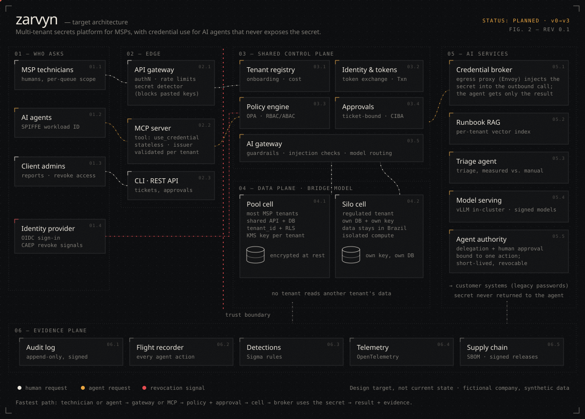

<p align="center"></p>

# Zarvyn

[English](README.md) | **Português**

[](docs/THREAT-MODEL.md)
[](#roadmap)
[](LICENSE)

> Uma API multi-tenant de segredos construída a partir do seu modelo de ameaças, com decisões, falhas e controles de segurança explícitos e mensuráveis.

## Sumário

- [Descrição do projeto](#descrição-do-projeto)
- [Situação atual](#situação-atual)
- [Modelo de segurança](#modelo-de-segurança)
- [Arquitetura](#arquitetura)
- [Arquitetura-alvo](#arquitetura-alvo)
- [Decisões de arquitetura](#decisões-de-arquitetura)
- [Stack](#stack)
- [Estrutura do projeto](#estrutura-do-projeto)
- [Roadmap](#roadmap)
- [Documentação](#documentação)
- [Contribuição e segurança](#contribuição-e-segurança)
- [Licença](#licença)
- [Autor](#autor)

## Descrição do projeto

**Zarvyn** é uma plataforma cloud-native e multi-tenant que armazena e gerencia
segredos e credenciais de organizações clientes.

Credenciais vazam por código, chat, chamados e planilhas compartilhadas, e quase
nunca são trocadas. O objetivo do Zarvyn é manter os segredos de cada organização
isolados, criptografados e auditáveis, para que cada acesso possa ser rastreado até
quem o fez e por quê.

O projeto é construído como um sistema de engenharia, não como uma coleção de
exercícios soltos. As decisões de segurança são documentadas antes da implementação
e depois validadas aos poucos, com experimentos controlados e evidência mensurável.

A evidência atual inclui:
- Modelagem de ameaças antes da implementação (STRIDE, PASTA, árvores de ataque)
- Requisitos definidos de isolamento entre tenants e de menor privilégio
- Escopo do projeto e fronteiras de segurança
- Regras de operação do purple team
- Registros de decisão de arquitetura (ADRs)

Capacidades planejadas, como criptografia em repouso, log de auditoria,
infraestrutura como código, gates de segurança no CI/CD e observabilidade, só serão
apresentadas como evidência depois que existirem no repositório e puderem ser
reproduzidas.

## Situação atual

O Zarvyn está na fase de fundação. O desenho de segurança vem primeiro: o modelo de
ameaças, o charter do projeto e as regras do purple team estão concluídos e
publicados antes de qualquer código de produção.

| Área                                                   | Situação                  |
| ------------------------------------------------------ | ------------------------- |
| Modelo de ameaças (STRIDE, PASTA, árvores de ataque)   | Concluído                 |
| Charter e escopo do projeto                            | Concluído                 |
| Charter e regras de laboratório do purple team         | Concluído                 |
| Registros de decisão de arquitetura                    | Em andamento (1 registro) |
| Implementação da API                                   | Não iniciada              |
| Infraestrutura como código                             | Não iniciada              |
| Pipeline de CI/CD                                      | Não iniciado              |

## Modelo de segurança

Segurança é desenhada antes do código, não adicionada depois. O modelo de ameaças
atual cobre as seis categorias do STRIDE e dois cenários de ataque completos,
documentados em [`docs/THREAT-MODEL.md`](docs/THREAT-MODEL.md) (em inglês).

| Princípio                 | Como se aplica                                             |
| ------------------------- | ---------------------------------------------------------- |
| **Menor privilégio**      | Cada identidade recebe só o que precisa                    |
| **Isolamento de tenants** | Nenhum tenant alcança os dados de outro                    |
| **Defesa em profundidade**| Várias camadas independentes, sem ponto único de falha     |
| **Auditabilidade**        | Toda ação sensível é registrada e atribuível               |
| **Zero trust**            | Autorização aplicada no servidor em toda requisição        |

## Arquitetura

O fluxo principal de uma requisição para guardar um segredo, como decomposto na
modelagem de ameaças. Cada etapa existe por um motivo e corresponde a uma ameaça
específica.

```
Cliente
│
▼
[1] A API recebe a requisição
│
▼
[2] Autenticação ── quem é?
│
▼
[3] Autorização ── tem permissão para isso?
│
▼
[4] Validação de entrada ── o conteúdo está bem formado?
│
▼
[5] Criptografia ── o segredo é cifrado antes de ser guardado
│
▼
[6] Vínculo ao tenant ── o segredo é ligado ao tenant correto
│
▼
[7] Persistência ── gravado em armazenamento seguro
│
▼
[8] Log de auditoria ── quem fez o quê, e quando
│
▼
[9] Resposta ao cliente
```

As etapas 2 e 3 formam a fronteira de confiança: antes delas, a requisição não é
confiável; depois, ela carrega uma identidade verificada e um conjunto definido de
permissões.

Detalhes em [`docs/architecture/`](docs/architecture/) (em inglês).

## Arquitetura-alvo

Para onde o Zarvyn vai até a v3: modelo bridge, com plano de controle
compartilhado, células de dados em pool e em silo, e agentes de IA que usam uma
credencial sem nunca recebê-la. Nada deste diagrama está implementado ainda; a
tabela de [Situação atual](#situação-atual) é a referência.



## Decisões de arquitetura

Decisões relevantes são registradas como ADRs em
[`docs/architecture/adr/`](docs/architecture/adr/). Cada registro traz o contexto,
a decisão e as consequências.

| ADR                                                            | Decisão                                   |
| -------------------------------------------------------------- | ----------------------------------------- |
| [0001](docs/architecture/adr/0001-threat-model-before-code.md) | Modelo de ameaças antes de escrever código |

## Stack

Stack planejada. Cada item só passa para a tabela de situação atual quando estiver
implementado e reproduzível neste repositório.

| Categoria                 | Tecnologia                           |
| ------------------------- | ------------------------------------ |
| **Núcleo da API**         | Python 3.12 (FastAPI)                |
| **Dados**                 | PostgreSQL                           |
| **Containers**            | Docker                               |
| **Infraestrutura**        | Terraform, AWS                       |
| **CI/CD**                 | GitHub Actions com gates de segurança |
| **Varredura de segurança**| Trivy, Checkov, SAST/SCA             |
| **Observabilidade**       | OpenTelemetry, Prometheus, Grafana   |

## Estrutura do projeto

O que existe hoje:

```
zarvyn/
├── docs/
│   ├── PROJECT-CHARTER.md      # Escopo, objetivos e limites
│   ├── THREAT-MODEL.md         # STRIDE, PASTA e árvores de ataque
│   ├── PURPLE-TEAM-CHARTER.md  # Missão e regras de laboratório do purple team
│   ├── CONVENTIONS.md          # Padrões de nomes e formatação
│   ├── ROADMAP-DOCS.md         # Quando cada seção da documentação entra
│   ├── assets/                 # Banner e figuras da arquitetura
│   └── architecture/
│       ├── README.md           # Fluxo da requisição e fronteiras de confiança
│       └── adr/                # Registros de decisão de arquitetura
├── CHANGELOG.md
├── CONTRIBUTING.md
├── LICENSE
├── README.md
├── README.pt-BR.md
└── SECURITY.md
```

Pastas de código (`src/`), testes (`tests/`), infraestrutura (`infra/`) e CI
(`.github/workflows/`) entram na fase que as implementa, seguindo a regra de
[`docs/ROADMAP-DOCS.md`](docs/ROADMAP-DOCS.md): nada é documentado antes de existir.

## Roadmap

**Fase 0 — Desenho de segurança (concluída)**

- [x] Charter do projeto, escopo e limites
- [x] Modelo de ameaças: STRIDE, PASTA e árvores de ataque
- [x] Charter e regras de laboratório do purple team
- [x] Primeiro ADR: modelo de ameaças antes do código

**Fase 1 em diante — Implementação**

- [ ] API principal com isolamento robusto entre tenants
- [ ] Camada de autenticação e autorização (RBAC/ABAC)
- [ ] Gestão de segredos e criptografia em repouso
- [ ] Log de auditoria e monitoramento centralizado
- [ ] Hardening de containers e imagens base mínimas
- [ ] Implantação com infraestrutura como código (AWS)
- [ ] Pipeline de CI/CD com gates de segurança automatizados

## Documentação

A documentação técnica é mantida em inglês.

- [Project Charter](docs/PROJECT-CHARTER.md) — escopo, objetivos e responsável
- [Threat Model](docs/THREAT-MODEL.md) — STRIDE, PASTA e árvores de ataque
- [Purple Team Charter](docs/PURPLE-TEAM-CHARTER.md) — missão, escopo e regras de laboratório
- [Architecture](docs/architecture/README.md) — fluxo da requisição e fronteiras de confiança
- [Conventions](docs/CONVENTIONS.md) — padrões de nomes e formatação

## Contribuição e segurança

Contribuições são bem-vindas. Leia o [CONTRIBUTING.md](CONTRIBUTING.md) antes; todo
commit precisa de sign-off (DCO). Reporte vulnerabilidades de forma privada, como
descrito no [SECURITY.md](SECURITY.md). O material de ataque deste repositório tem
como alvo apenas o laboratório do Zarvyn e se limita ao necessário para provar um
controle.

## Licença

Licenciado sob a Apache License 2.0. Veja [LICENSE](LICENSE).

## Autor

**Luan Thales** — Cloud Security Specialist · [LinkedIn](https://www.linkedin.com/in/luanthales) · [GitHub](https://github.com/zar4t)
